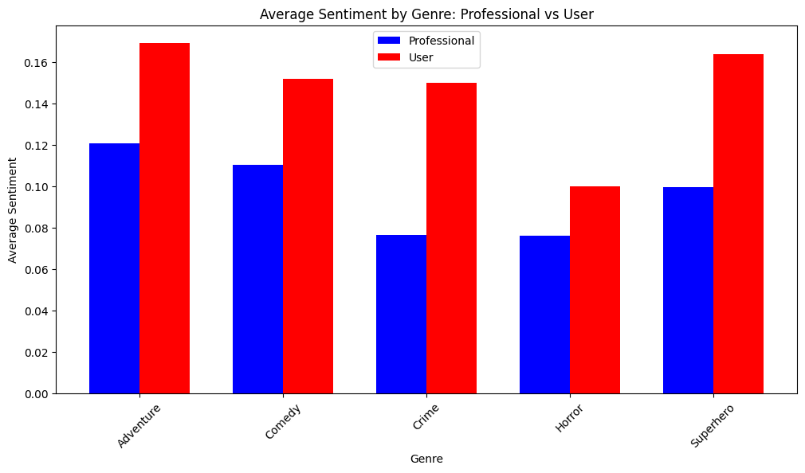
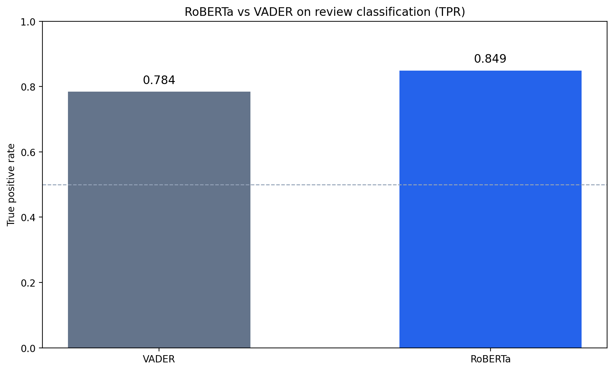
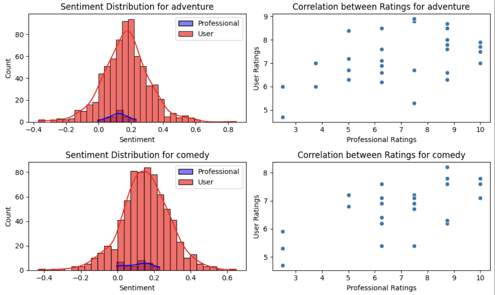
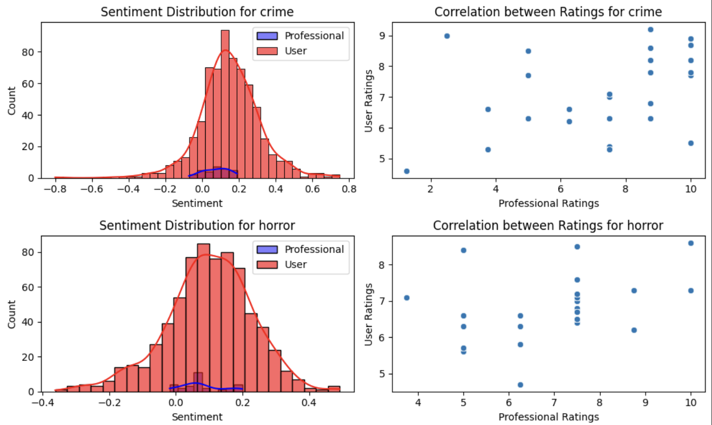
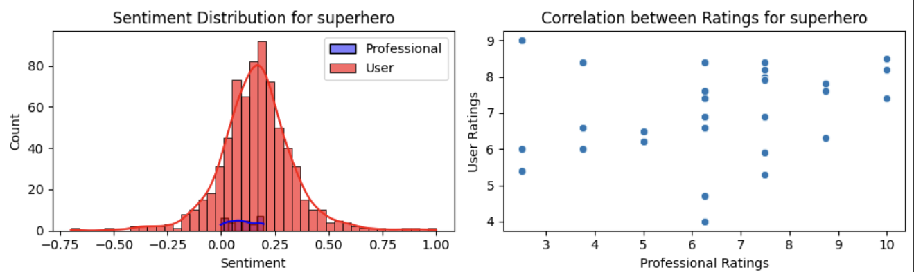

# Analyzing Movie Reviews Across Genres and Reviewer Types

A comparative sentiment and rating analysis of movie reviews scraped from IMDb (general audiences) and RogerEbert.com (professional critics) across five genres: Adventure, Comedy, Crime, Horror, and Superhero.

**Team:** Evan Carlson, Roy Ho, Elpidio Azarcon
**Course:** STA 141B — Data & Web Technologies for Data Analysis, UC Davis
**Date:** February – March 2025

## Overview

The goal of this project was to quantify how professional critics and general audiences differ in how they rate and discuss films, and whether those differences vary by genre. We scraped roughly 3,500 user reviews from IMDb and 148 professional reviews from RogerEbert.com, normalized the two rating scales, and ran both a rule-based (VADER) and a transformer-based (RoBERTa) sentiment classifier on the review text.

### Three questions we set out to answer

1. How do sentiments in movie reviews vary across genres?
2. How do reviews differ between professional critics and general users?
3. Is there a correlation between critic ratings and audience ratings?

## Key findings

- **Professionals are stricter and more varied.** Critic ratings have higher standard deviations across every genre, meaning critics are more willing to give extreme scores. User ratings cluster more tightly around the mean.
- **Users skew positive on Adventure and Superhero;** professionals skew higher on Comedy, Crime, and Horror.
- **Comedy sees the strongest critic/audience agreement** (r ≈ 0.63). **Superhero sees the weakest** (r ≈ 0.25), suggesting critics and audiences evaluate superhero films on different criteria (craft vs. fandom experience).
- **RoBERTa outperformed VADER** on sentiment classification (TPR 0.85 vs. 0.78), especially on detecting negative reviews.

Full methodology and discussion: [`report/final_report.pdf`](report/final_report.pdf).

## Screenshots

### Sentiment by genre



Average professional vs user sentiment across five genres.

### RoBERTa vs VADER



True positive rate on the same review-classification task. RoBERTa 0.849 vs VADER 0.784.

### Adventure and comedy



Sentiment distributions and rating correlations for two genres.

### Crime and horror



Sentiment distributions and rating correlations for two genres.

### Superhero



Sentiment distribution and rating correlation for superhero films.

## Repository structure

```
movie-reviews-analysis/
├── data/
│   ├── user_reviews/                 IMDb reviews, one CSV per genre
│   │   ├── adventure.csv
│   │   ├── comedy.csv
│   │   ├── crime.csv
│   │   ├── horror.csv
│   │   └── superhero.csv
│   └── professional_reviews/         RogerEbert reviews, one CSV per genre
│       ├── adventure.csv
│       ├── comedy.csv
│       ├── crime.csv
│       ├── horror.csv
│       └── superhero.csv
├── notebooks/
│   ├── 01_scraping.ipynb             IMDb + RogerEbert scrapers
│   ├── 02_sentiment_analysis.ipynb   VADER classification + RoBERTa notes
│   └── 03_eda_and_visualizations.ipynb   Rating distributions, correlations, TextBlob EDA
├── report/
│   └── final_report.pdf              Full written writeup
├── requirements.txt
├── .gitignore
└── README.md
```

## Getting started

### 1. Clone and install

```bash
git clone https://github.com/royho1/movie-reviews-analysis.git
cd movie-reviews-analysis
pip install -r requirements.txt
```

### 2. Run the notebooks

The scraped CSV data is already committed to the repo, so you can jump straight to the analysis notebooks:

```bash
jupyter notebook notebooks/03_eda_and_visualizations.ipynb
```

The scraping notebook (`01_scraping.ipynb`) is included for completeness but does not need to be re-run — the scrape takes about 40 minutes per genre because of IMDb's spoiler-warning click-to-reveal UI, which requires Selenium.

## Scraping notes

Two challenges made the scraping non-trivial:

- **IMDb spoiler warnings:** reviews tagged as spoilers hide their text behind a "Show more" icon. The full review text is not in the initial HTML. We used a Selenium WebDriver to click the icon, wait for the DOM to update, then extract the text.
- **Different rating scales:** RogerEbert rates movies on a 0–4 star scale, and the star count is encoded only in the CSS class name of the filled-stars image (`h-7 filled star05`, `star10`, ..., `star40`). We pull the class name via XPath, regex out the integer, and rescale to IMDb's 0–10.

## Team contributions

From the final report:

- **Evan Carlson** — Scraped and processed all IMDb data; fit the VADER sentiment model.
- **Elpidio Azarcon** — Scraped the professional reviews from RogerEbert; created the final visualizations.
- **Roy Ho** — Scraped the professional review ratings (the CSS-class-based rating extraction described above); fit the RoBERTa NLP model.

All three of us wrote our respective sections of the report.

## Models used

- **VADER** (`nltk.sentiment.vader.SentimentIntensityAnalyzer`) — rule-based, bag-of-words
- **RoBERTa** (`cardiffnlp/twitter-roberta-base-sentiment`, Hugging Face) — transformer model with a custom `split_text()` chunker to respect the 512-token limit, then majority-vote aggregation across chunks
- **TextBlob** polarity — used only for exploratory sentiment histograms in the EDA notebook

## Limitations

- Each genre took about 40 minutes to scrape, so we limited ourselves to five genres rather than covering IMDb's full catalog.
- RogerEbert has roughly one professional review per movie, versus hundreds of user reviews per movie on IMDb. Descriptive statistics for professionals are therefore based on a much smaller sample.

## Built with

Python, pandas, matplotlib, seaborn, Requests, lxml, Selenium, NLTK (VADER), TextBlob, Hugging Face Transformers (RoBERTa), scikit-learn.
